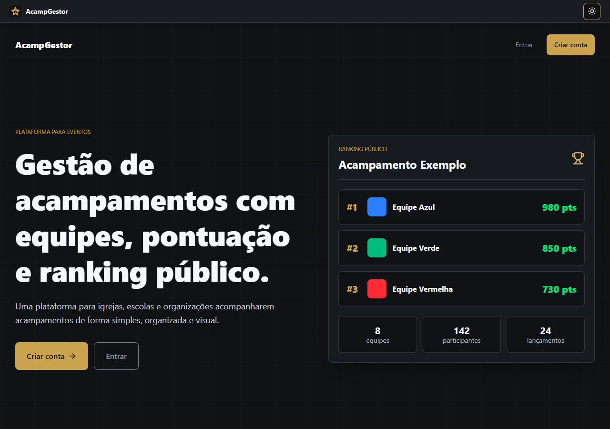
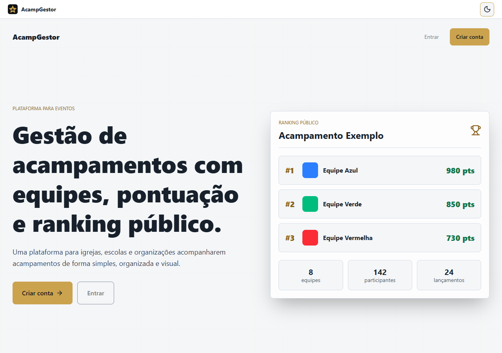

# AcampGestor

Plataforma web para organizar acampamentos, retiros e eventos com equipes, quartos, participantes e competições. Reúne pontuações, penalidades, gincanas, inspeções, ranking público e exportação em Excel.

A V2 utiliza um modelo unificado: cada equipe participa das competições e possui seus quartos. As inspeções dos quartos pontuam a equipe correspondente. Os dados permanecem separados por acampamento, com painéis distintos para a administração da plataforma e para os gestores.

## Demonstração

**Aplicação:** [acampgestor.vercel.app](https://acampgestor.vercel.app)

A página institucional e os rankings habilitados são públicos. As áreas operacionais exigem autenticação e permissão de acesso. O cadastro de gestores depende da disponibilidade configurada na plataforma.

Capturas reais da página pública da V2, sem dados de usuários. A prévia de ranking na landing é ilustrativa e não representa registros de produção:

| Tema escuro | Tema claro |
| --- | --- |
|  |  |

## Funcionalidades

- **Plataforma ADMIN:** dashboard, gestão de usuários, organizações e acampamentos, com acesso administrativo às operações.
- **Área do gestor:** criação e gerenciamento de múltiplos acampamentos independentes.
- **Contas:** edição do próprio nome e senha; ADMIN gerencia acessos, e-mails e recuperação de contas de gestores. Alteração do próprio e-mail pelo gestor permanece desabilitada.
- **Ciclo dos acampamentos:** arquivamento, restauração e exclusão definitiva com confirmação e autorização do proprietário ou ADMIN; exclusão de contas protegida pelo backend.
- **Equipes e quartos:** equipes competitivas com seus quartos e participantes vinculados à equipe e ao quarto correspondente.
- **Participantes:** cadastro, edição, consulta e organização por equipe e quarto.
- **Pontuação:** pontos positivos, penalidades, histórico e totalização por equipe.
- **Gincanas:** registro de atividades e premiação de várias equipes com valores definidos pelo gestor.
- **Inspeções:** resultados por quarto, pontuação da equipe responsável e configuração independente de 21 combinações de dia e turno por acampamento.
- **Histórico:** autoria dos novos lançamentos e preservação dos registros anteriores.
- **Ranking público:** classificação por equipe em uma URL própria do acampamento, sem exigir login e sem expor dados pessoais completos dos participantes.
- **Exportação:** arquivo Excel por acampamento com dados operacionais, resultados e estatísticas.
- **Interface:** responsividade, temas claro e escuro e identidade dourada.
- **Acesso e isolamento:** Supabase Auth, perfis ADMIN/GESTOR, políticas RLS e operações transacionais no PostgreSQL.

O manifesto web e os ícones permitem adicionar o aplicativo à tela inicial em navegadores compatíveis. A aplicação requer conexão; não mantém dados privados em cache offline.

## Tecnologias

- React, JavaScript e Vite.
- Tailwind CSS, React Router e Lucide React.
- Supabase Auth e PostgreSQL, com Row Level Security e funções RPC transacionais.
- ExcelJS e file-saver para exportação.
- Node.js test runner (`node:test`) para testes automatizados.
- GitHub e Vercel para versionamento e publicação.

## Estrutura do projeto

```text
public/           Ícones, manifesto, metadados sociais, robots e sitemap
src/
  components/     Componentes compartilhados
  domain/         Regras puras de ranking e pontuação
  features/       Fluxos e validações por funcionalidade
  hooks/          Hooks compartilhados
  lib/            Integrações e configuração do cliente
  pages/          Páginas públicas e painéis
  utils/          Utilitários
supabase/
  functions/      Edge Functions e compatibilidade histórica
  sql/            Evolução do schema, funções e políticas RLS
  tests/          Verificações SQL
tests/            Integração em memória e ferramentas de QA
docs/             Documentação técnica, capturas e notas de versão
```

A aplicação **2.0.0** está publicada, com validação operacional real dos fluxos principais e exclusão controlada do acampamento exclusivo de QA concluídas. Os demais dados e acessos foram preservados. Exclusão real de contas, concorrência, restauração de backup e validação final em dispositivos físicos permanecem não concluídas. Consulte as [notas da V2.0.0](docs/releases/v2.0.0.md) e a [GitHub Release](https://github.com/branchescunha/acampgestor/releases/tag/v2.0.0).

## Autor

André Vinícius Branches Cunha
